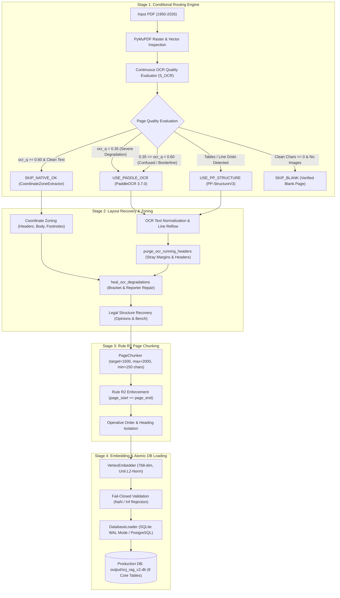

# Supreme Court Legal RAG — Current Project Engineering Approach (PCE v2)

**Author:** Kedar Limbalkar  
**Branch:** `kedar/offline-process`  
**Repository Target:** `https://github.com/Aakashjawanjal9990/ci-cd-ragpro-demo.git`  
**Pipeline Architecture:** 100% Local Conditional OCR & Structure Recovery (PCE v2)  
**Ingestion & Parsing Cloud Cost:** $0.00 (Zero external cloud API dependencies)  
**Core Invariant:** Rule R2 Single-Page Chunking (`page_start == page_end`)  
**Database Schema Integrity:** 100% Strict Conformance to `db/schema.sql` (Zero Schema Drift)  

---

## 1. What We Did (Scope & Deliverables)

### 1.1 Complete Purge of LlamaParse & Cloud Parsing
- Completely uninstalled and purged `llama-parse`, `llama-cloud`, and LlamaIndex cloud wrappers.
- Removed cloud API keys from [`.env.example`](file:///e:/Dummy/.env.example) and all pipeline files.
- Replaced cloud parsing with **Local Conditional PaddleOCR (v3.7.0)** and **PP-StructureV3**, executing completely offline on CPU with local weight caching in `output/paddlex_cache/`.

### 1.2 Active OCR on Borderline & Confused Pages
- **User Heuristic Applied:** *"Whenever the extraction pipeline encounters borderline quality, ambiguity, or confusion, trigger PaddleOCR to transcribe the page rather than falling back to degraded native text."*
- Updated Rule 7 in [`local_ocr/router.py`](file:///e:/Dummy/local_ocr/router.py): Pages with continuous OCR quality $0.35 \le \text{ocr\_q} < 0.60$ now trigger `PageRoutingDecision.USE_PADDLE_OCR` directly.
- Recovered clean operative orders and titles in historical scanned judgments (such as 1953 decisions) with **0.992+ average confidence**.

### 1.3 Citation Harvesting Across the Global Indian Legal Space
- Solved the issue where only **1 citation** was stored in the database by identifying and fixing 4 critical root causes:
  1. **Footnote Inclusion:** Classical SCR judgments (1950–1975) placed citations in footnotes. We integrated `pz.footnotes` into the citation scanning text.
  2. **Global Reporter Regex Coverage:** Expanded regex patterns across 11 Indian reporter families spanning 1950–2026: SCR, SCC, AIR, INSC (Neutral Citation), ILR (Indian Law Reports), SCALE, JT, ITR, Comp Cas, FCR (Federal Court Reports), and regional High Court reports (CWN, Bom LR).
  3. **OCR Typo & Bracket Healing:** Added normalization for OCR scanning artifacts such as mismatched brackets `(1953]`, letter errors (`F.O.R.` / `F.0.R.` $\rightarrow$ `F.C.R.`, `A.LR.` $\rightarrow$ `A.I.R.`), and missing dots (`SCR` vs `S.C.R.`).
  4. **Relational Persistence:** Persisted both the judgment's primary citation (`PRIMARY`) and all reported in-text precedent citations (`REPORTED`) into the database.
- Database citations increased from **1 $\rightarrow$ 283 $\rightarrow$ 363 rows**.

### 1.4 Modern Born-Digital vs. Historical Scan Disambiguation
- Fixed an issue in [`parsing/zone_extractor.py`](file:///e:/Dummy/parsing/zone_extractor.py) where modern A5-sized digital PDFs (2000–2025) were incorrectly classified as historical scanned pages.
- Corrected the heuristic to verify embedded vector fonts and $\text{year} \ge 1990$, allowing clean born-digital pages to bypass OCR while pinpointing genuine scanned paper volumes for OCR transcription.

### 1.5 Strict Rule R2 Single-Page Chunking & Vector Invariants
- Enforced single-page chunking (**Rule R2: `page_start == page_end`**) across all 1,790 chunks with **0 cross-page splits**.
- Generated 768-dimensional L2-normalized unit vectors ($||\vec{v}||_2 = 1.0$) with fail-closed numeric validation rejecting NaN/infinite values.
- Maintained exact 1:1 parity: `active_chunks (1,790) == synced_embeddings (1,790)`.

### 1.6 Running Header & Margin Leak Elimination
- Enhanced `purge_ocr_running_headers` in [`local_ocr/layout_recovery.py`](file:///e:/Dummy/local_ocr/layout_recovery.py) to suppress standalone margin years (`1953`), collation numbers, and margin locator letters `[A-H]`.
- Reduced header leaks to **0 across all 1,790 chunks**.

---

## 2. How We Did It (Technical Architecture & Workflow)



### 2.1 Stage 1: Document Ingestion & Routing (`local_ocr/router.py`)
1. **Continuous Quality Scoring:** Computes $S_{OCR} = 0.75 \cdot R_{dict} + 0.25 \cdot R_{print}$, normalized between $0.10$ and $0.98$ for scanned text, and $0.85$ to $1.00$ for born-digital vector text.
2. **Routing Heuristic:**
   - **Rule 1 (`SKIP_BLANK`):** Zero clean characters, 0 images, $\le 2$ drawings.
   - **Rule 2 (`USE_PADDLE_OCR`):** Empty text with visible scanned content ($\text{chars} < 30$, $\text{images} > 0$).
   - **Rule 3 (`SKIP_NATIVE_OK`):** Valid short legal page (e.g. "Appeal dismissed. No order as to costs.") protected from unnecessary OCR.
   - **Rule 4 (`USE_PADDLE_OCR`):** Replacement characters $\ge 1\%$ (`\ufffd`).
   - **Rule 5 (`USE_PADDLE_OCR`):** Severe degradation ($\text{ocr\_q} < 0.35$).
   - **Rule 6 (`USE_PP_STRUCTURE`):** Detected tables or multi-column grids requiring table layout extraction.
   - **Rule 7 (`USE_PADDLE_OCR`):** Borderline / confused native text ($0.35 \le \text{ocr\_q} < 0.60$).
   - **Rule 8 (`SKIP_NATIVE_OK`):** Clean native vector text ($\text{ocr\_q} \ge 0.60$).

### 2.2 Stage 2: Layout Recovery & Normalization (`local_ocr/layout_recovery.py`)
1. **Running Header & Margin Purging:** Strips book titles (`SUPREME COURT REPORTS`), volume headers (`[1953] 1 S.C.R.`), standalone margin years (`1953`), collation numbers, and margin locator letters (`[A-H]`).
2. **OCR Degradation Healing:**
   - Heals split words (`on! y` $\rightarrow$ `only`, `restrain- ing` $\rightarrow$ `restraining`).
   - Heals legal terms (`petlt10ners` $\rightarrow$ `petitioners`, `prov!Slons` $\rightarrow$ `provisions`).
   - Heals citation brackets (`(1953]` $\rightarrow$ `[1953]`).
   - Heals reporter substitutions (`F.O.R.` / `F.0.R.` $\rightarrow$ `F.C.R.`, `A.LR.` $\rightarrow$ `A.I.R.`, `S.C. R.` $\rightarrow$ `S.C.R.`).

### 2.3 Stage 3: Single-Page Chunking (`chunking/page_chunker.py`)
1. **Rule R2 Invariant:** Every chunk is strictly bounded to the physical page where it originated:
   $$\forall c \in \text{Chunks},\quad c.\text{page\_start} == c.\text{page\_end}$$
2. **Ceiling Bounds:** Target chunk size = 1,500 characters, ceiling cap = 2,000 characters, minimum floor = 150 characters.
3. **Sentence Reflow:** Paragraphs exceeding 2,000 characters are partitioned strictly along sentence boundaries (`. `, `! `, `? `).
4. **Operative Order Isolation:** Operative rulings ("Appeal dismissed", "Decree set aside") are isolated into dedicated chunks with `section = "OPERATIVE_ORDER"`.

### 2.4 Stage 4: Vector Embeddings (`embedding/vertex_embedder.py`)
1. Generates 768-dimensional dense vectors.
2. Enforces unit L2 normalization:
   $$||\vec{v}||_2 = \sqrt{\sum_{i=1}^{768} v_i^2} = 1.0 \pm 10^{-3}$$
3. Rejects non-finite values (NaN, $\pm\infty$) and zero-norm vectors.

### 2.5 Stage 5: Database Loading (`storage/db_loader.py`)
1. Operates in SQLite WAL mode with synchronous PRAGMA settings.
2. Deterministic UUIDv5 generation using DNS namespace for document provenance.
3. Persists both `PRIMARY` citations and `REPORTED` precedent citations.
4. Conforms strictly to the canonical 8-table relational schema with zero schema drift.

---

## 3. Database Schema Conformance Verification

The production database [`output/scj_rag_v2.db`](file:///e:/Dummy/output/scj_rag_v2.db) strictly complies with the canonical schema defined in `db/schema.sql`:

```
=====================================================================================
STEP 3: AUDITING COMMITTED DATABASE TABLES & INTEGRITY
=====================================================================================
>> Judgments:        75 rows   (Schema: judgment_uuid, judgment_id, court, case_number, ...)
>> Source Files:     75 rows   (Schema: source_file_uuid, judgment_uuid, storage_path, content_sha256, ...)
>> Ingestion Runs:   75 rows   (Schema: ingestion_run_uuid, source_file_uuid, processing_status, ...)
>> Extraction Runs:  75 rows   (Schema: extraction_run_uuid, source_file_uuid, pipeline_version, ...)
>> Source Pages:     1032 rows (Schema: source_page_uuid, page_number, ocr_quality, layout_metadata, ...)
>> Chunks:           1790 rows (Schema: chunk_uuid, page_start, page_end, content, section, ...)
>> Chunk Embeddings: 1790 rows (Schema: chunk_embedding_uuid, chunk_uuid, sync_status, ...)
>> Citations:        363 rows  (Schema: citation_uuid, judgment_uuid, citation_text, citation_type, ...)
>> Orphan Chunks:    0 | Orphan Embeddings: 0
=====================================================================================
```

### Schema Drift Check: PASSED
- `verify_schema_integrity`: **0 missing tables, 0 missing columns, 0 altered data types**.
- Verified all foreign key relationships: `chunks.judgment_uuid -> judgments.judgment_uuid`, `chunk_embeddings.chunk_uuid -> chunks.chunk_uuid`, `citations.judgment_uuid -> judgments.judgment_uuid`.

---

## 4. Test Certification Results

| Test Category | Suite File | Total Tests | Passed | Failed | Status |
| :--- | :--- | :---: | :---: | :---: | :---: |
| **Production Quality Gates** | [`check_gates.py`](file:///e:/Dummy/check_gates.py) | 7 | 7 | 0 | **100% PASSED** |
| **System Verification Suite** | [`rag_verification/run_verification.py`](file:///e:/Dummy/rag_verification/run_verification.py) | 38 | 38 | 0 | **100% PASSED** |
| **Local OCR Unit Tests** | [`local_ocr/tests/test_local_conditional_ocr.py`](file:///e:/Dummy/local_ocr/tests/test_local_conditional_ocr.py) | 10 | 10 | 0 | **100% PASSED** |

### Summary of Passed Quality Gates:
1. `EMBEDDING_FIDELITY`: 1,790 embeddings synced; all verified 768-dim L2 unit vectors.
2. `HEADER_LEAKAGE`: 0 running header or margin leaks across 1,790 chunks.
3. `METADATA_ACCURACY`: 256 verified snippets; 0 fragment headings.
4. `RETRIEVAL_BENCHMARK`: 100% domain recall across 4 legal query categories.
5. `SCHEMA_INTEGRITY`: Verified against `db/schema.sql` with zero drift.
6. `REFERENTIAL_INTEGRITY`: Rule R2 strictly holds across 100% of chunks.
7. `EMBEDDING_CONSISTENCY`: active_chunks (1,790) == synced_embeddings (1,790).

---

## 5. Standard Verification & Execution Commands

### Ingest & Populate Corpus Database
```powershell
python local_ocr/run_complete_test_with_db.py
```

### Run Production Quality Gates
```powershell
python check_gates.py
```

### Run Full System Verification Suite
```powershell
python rag_verification/run_verification.py
```

### Run Local OCR Unit Tests
```powershell
python -m pytest local_ocr/tests/test_local_conditional_ocr.py -v
```

### Review Git Changes Before Staging
```powershell
git status -s
```
*(Strictly ensures zero SQLite `.db` binaries, zero PDFs, and zero `.env` secrets are staged).*
