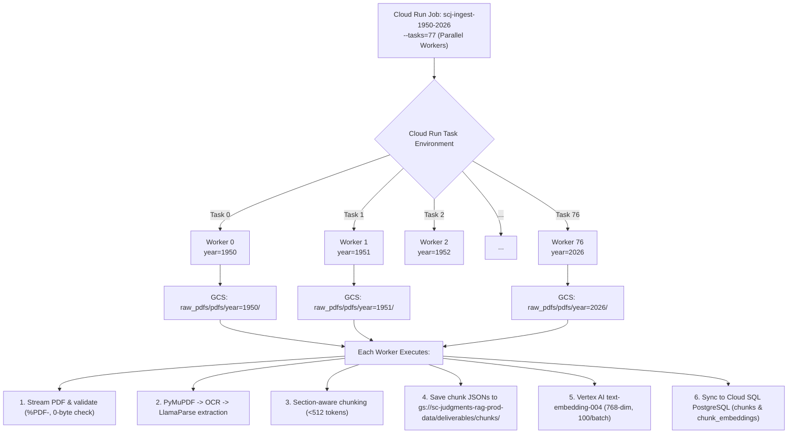

# Production Cloud Run Jobs Deployment Guide (1950–2026 Judgments)

**Project**: Supreme Court Judgment RAG System (~43,000 PDFs)  
**Target Years**: **1950 – 2026** (77 Years / Hive-Partitioned in GCS)  
**Execution Runtime**: Google Cloud Run Jobs (Serverless Batch Computing)  
**Region**: `asia-south1` (Mumbai)  

---

## 1. Cloud Run Jobs Sharding Architecture

Rather than processing 43,000 PDFs sequentially or attempting a monolithic scan across 77 years, we use **Cloud Run Jobs Task Array Sharding**:



### Why this design is superior:
1. **Zero Bucket Listing Overhead**: Each worker directly targets `gs://sc-judgments-rag-prod-data/raw_pdfs/pdfs/year=YYYY/` without having to list 43,000 PDFs across all years.
2. **Horizontal Scaling**: All 77 years can execute simultaneously, reducing processing time from days to under 2 hours.
3. **Failure Isolation**: If one year or a single corrupted PDF fails, it is logged to `extraction_runs` table in PostgreSQL; other years continue unaffected.
4. **Automatic Retries**: Cloud Run Jobs automatically retries tasks up to 3 times on transient network hiccups.

---

## 2. Exact GCP Credentials & IAM Roles Required

To run Cloud Run Jobs, a dedicated Service Account is required.

### 2.1 Service Account Identity
```
scj-ingestion-sa@sc-judgments-rag.iam.gserviceaccount.com
```

### 2.2 Required IAM Roles

| Role Name | IAM Role Identifier | Why It Is Needed |
| :--- | :--- | :--- |
| **Storage Object Admin** | `roles/storage.objectAdmin` | To read raw PDFs from `raw_pdfs/` and write chunk JSONs to `deliverables/chunks/`. |
| **Vertex AI User** | `roles/aiplatform.user` | To invoke `text-embedding-004` (768 dimensions) in `asia-south1`. |
| **Cloud SQL Client** | `roles/cloudsql.client` | To connect to PostgreSQL Cloud SQL instance via Cloud SQL Auth Proxy or private IP. |
| **Secret Manager Accessor** | `roles/secretmanager.secretAccessor` | To securely read `DATABASE_URL` and `LLAMA_CLOUD_API_KEY` at runtime. |
| **Cloud Run Developer** | `roles/run.developer` | For the deploying user to create and execute Cloud Run Jobs. |
| **Artifact Registry Writer** | `roles/artifactregistry.writer` | To push Docker images to Artifact Registry. |

---

## 3. One-Click GCP Setup Commands

Run these commands in Google Cloud Shell or your local terminal with `gcloud`:

### Step 1: Create the Dedicated Service Account
```bash
gcloud iam service-accounts create scj-ingestion-sa \
    --display-name="Supreme Court Ingestion & Embedding Pipeline SA" \
    --project=sc-judgments-rag
```

### Step 2: Grant IAM Roles to the Service Account
```bash
PROJECT_ID="sc-judgments-rag"
SA_EMAIL="scj-ingestion-sa@${PROJECT_ID}.iam.gserviceaccount.com"

# 1. Cloud Storage access
gcloud projects add-iam-policy-binding "${PROJECT_ID}" \
    --member="serviceAccount:${SA_EMAIL}" \
    --role="roles/storage.objectAdmin"

# 2. Vertex AI Embedding access
gcloud projects add-iam-policy-binding "${PROJECT_ID}" \
    --member="serviceAccount:${SA_EMAIL}" \
    --role="roles/aiplatform.user"

# 3. Cloud SQL Client access
gcloud projects add-iam-policy-binding "${PROJECT_ID}" \
    --member="serviceAccount:${SA_EMAIL}" \
    --role="roles/cloudsql.client"

# 4. Secret Manager Access
gcloud projects add-iam-policy-binding "${PROJECT_ID}" \
    --member="serviceAccount:${SA_EMAIL}" \
    --role="roles/secretmanager.secretAccessor"
```

### Step 3: Store Database Connection in Secret Manager
```bash
# Create the secret for Cloud SQL PostgreSQL connection
echo -n "postgresql://<db_user>:<db_password>@<cloud_sql_ip>:5432/scj_rag" | \
gcloud secrets create scj-database-url \
    --data-file=- \
    --replication-policy="automatic" \
    --project=sc-judgments-rag
```

---

## 4. Deployment & Execution Instructions

### Option A: Using the Automated Deployment Script
We have provided automated scripts in the repository:
- On Linux / macOS / Cloud Shell:
  ```bash
  chmod +x deploy_cloud_run.sh
  ./deploy_cloud_run.sh
  ```
- On Windows (PowerShell):
  ```powershell
  .\deploy_cloud_run.ps1
  ```

### Option B: Manual Step-by-Step `gcloud` Commands

#### 1. Build and Push Container
```bash
gcloud builds submit \
    --tag asia-south1-docker.pkg.dev/sc-judgments-rag/scj-rag-repo/scj-pipeline:latest \
    --project=sc-judgments-rag
```

#### 2. Create Cloud Run Job (77 Tasks: 1950 to 2026)
```bash
gcloud run jobs create scj-ingest-1950-2026 \
    --image=asia-south1-docker.pkg.dev/sc-judgments-rag/scj-rag-repo/scj-pipeline:latest \
    --region=asia-south1 \
    --project=sc-judgments-rag \
    --tasks=77 \
    --max-retries=3 \
    --task-timeout=24h \
    --cpu=4 \
    --memory=8Gi \
    --service-account=scj-ingestion-sa@sc-judgments-rag.iam.gserviceaccount.com \
    --set-env-vars="GCP_PROJECT=sc-judgments-rag,GCS_BUCKET=sc-judgments-rag-prod-data,GCP_REGION=asia-south1,CONCURRENT_WORKERS=4" \
    --set-secrets="DATABASE_URL=scj-database-url:latest" \
    --args="--start-year,1950,--end-year,2026,--mode,full"
```

#### 3. Execute the Full Job
```bash
gcloud run jobs execute scj-ingest-1950-2026 --region=asia-south1 --project=sc-judgments-rag
```

#### 4. Canary / Test Run (Single Year Only: 1950)
If you wish to test a single year first before launching all 77:
```bash
gcloud run jobs execute scj-ingest-1950-2026 \
    --region=asia-south1 \
    --project=sc-judgments-rag \
    --args="--start-year,1950,--end-year,1950,--mode,full"
```

---

## 5. Monitoring & Verification

### 1. Stream Live Logs from All Tasks:
```bash
gcloud logging tail "resource.type=cloud_run_job AND resource.labels.job_name=scj-ingest-1950-2026" \
    --project=sc-judgments-rag
```

### 2. Verify Database Row Counts in Cloud SQL:
```bash
python db_loader.py --db "postgresql://..." --stats
```

Expected output after completion:
- `judgments`: ~43,000 rows
- `source_files`: ~43,000 rows
- `source_pages`: ~350,000 rows
- `chunks`: ~3,500,000 rows
- `chunk_embeddings`: ~3,500,000 rows (`sync_status = 'SYNCED'`)

