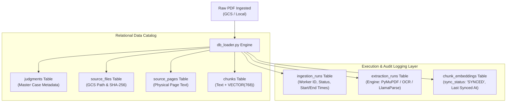

# Database Logging, Audit Trail & Execution Tracking Specification

**Target Audience**: Anuradha (Database Architect), DevOps & Operations Team  
**Author**: Kedar (Data Ingestion & Pipeline Engineer)  
**System**: Supreme Court Judgment RAG Platform  
**Scale**: ~43,000 Judgments | ~3.5 Million Chunks  

---

## 1. Overview: How Database Logs are Saved

Every time the ingestion or embedding pipeline runs (locally or in Cloud Run Jobs), execution logs are **not just printed to console**—they are **structured and persisted directly into PostgreSQL Cloud SQL** across 3 dedicated audit and logging tables:



---

## 2. The 3 Dedicated Database Log Tables

### 2.1 Table: `ingestion_runs` (Batch Execution Log)
Tracks every batch job execution, container worker, and idempotency status.

```sql
CREATE TABLE IF NOT EXISTS ingestion_runs (
    ingestion_run_uuid UUID PRIMARY KEY DEFAULT gen_random_uuid(),
    source_file_uuid UUID NOT NULL REFERENCES source_files(source_file_uuid) ON DELETE CASCADE,
    pipeline_name TEXT NOT NULL DEFAULT 'scj-data-ingestion-v1',
    processing_status TEXT NOT NULL,                  -- 'COMPLETED', 'FAILED'
    error_message TEXT,                              -- NULL on success; exact error message on failure
    retry_count INTEGER NOT NULL DEFAULT 0,          -- Number of retries attempted
    max_attempts INTEGER NOT NULL DEFAULT 3,
    idempotency_key TEXT NOT NULL UNIQUE,            -- Deterministic hash preventing duplicate work
    worker_id TEXT,                                  -- e.g. 'cloud-run-task-0', 'local-worker-4'
    started_at TIMESTAMPTZ,                          -- Timestamp when worker started
    heartbeat_at TIMESTAMPTZ,
    finished_at TIMESTAMPTZ,                         -- Timestamp when worker completed
    created_at TIMESTAMPTZ NOT NULL DEFAULT CURRENT_TIMESTAMP
);
```

#### How it gets saved:
When a PDF is processed by `db_loader.py`:
```python
conn.execute(text("""
    INSERT INTO ingestion_runs (
        ingestion_run_uuid, source_file_uuid, pipeline_name,
        processing_status, idempotency_key, worker_id,
        started_at, finished_at
    ) VALUES (
        :run_uuid, :file_uuid, 'scj-data-ingestion-v1',
        'COMPLETED', :idempotency_key, :worker_id,
        :start_time, :finish_time
    );
"""), {...})
```

---

### 2.2 Table: `extraction_runs` (Parser & OCR Audit Log)
Tracks which extraction engine was triggered for each PDF (PyMuPDF fast path, 200 DPI Tesseract OCR fallback, or LlamaParse v2).

```sql
CREATE TABLE IF NOT EXISTS extraction_runs (
    extraction_run_uuid UUID PRIMARY KEY DEFAULT gen_random_uuid(),
    source_file_uuid UUID NOT NULL REFERENCES source_files(source_file_uuid) ON DELETE CASCADE,
    ingestion_run_uuid UUID REFERENCES ingestion_runs(ingestion_run_uuid) ON DELETE SET NULL,
    pipeline_version TEXT NOT NULL DEFAULT 'pymupdf', -- 'pymupdf', 'tesseract_ocr', 'llamaparse'
    processing_status TEXT NOT NULL DEFAULT 'COMPLETED',
    error_message TEXT,
    retry_count INTEGER NOT NULL DEFAULT 0,
    started_at TIMESTAMPTZ,
    finished_at TIMESTAMPTZ,
    created_at TIMESTAMPTZ NOT NULL DEFAULT CURRENT_TIMESTAMP
);
```

#### How it gets saved:
If a PDF is historical (e.g. 1950s scanned S.C.R.) and PyMuPDF detects low-quality text, Tesseract OCR is triggered. The engine logs:
- `pipeline_version = 'tesseract_ocr'`
- `ocr_applied_pages = [1, 2, 5]`
- `finished_at = CURRENT_TIMESTAMP`

---

### 2.3 Table: `chunk_embeddings` (Vector Sync & Multi-Store Audit)
Tracks vector synchronization status across stores (`pgvector` in Cloud SQL vs GCS JSON deliverables).

```sql
CREATE TABLE IF NOT EXISTS chunk_embeddings (
    chunk_embedding_uuid UUID PRIMARY KEY DEFAULT gen_random_uuid(),
    chunk_uuid UUID NOT NULL REFERENCES chunks(chunk_uuid) ON DELETE CASCADE,
    embedding_model_uuid UUID REFERENCES embedding_models(embedding_model_uuid) ON DELETE SET NULL,
    provider TEXT NOT NULL DEFAULT 'vertex_ai',
    vector_store TEXT DEFAULT 'pgvector',
    sync_status TEXT NOT NULL DEFAULT 'SYNCED',       -- 'PENDING', 'SYNCED', 'FAILED'
    last_synced_at TIMESTAMPTZ,
    last_error TEXT,
    created_at TIMESTAMPTZ NOT NULL DEFAULT CURRENT_TIMESTAMP,
    updated_at TIMESTAMPTZ NOT NULL DEFAULT CURRENT_TIMESTAMP,
    UNIQUE (chunk_uuid, embedding_model_uuid)
);
```

#### How it gets saved:
When `batch_embedder.py` generates the 768-dim dense vector:
```sql
INSERT INTO chunk_embeddings (
    chunk_embedding_uuid, chunk_uuid, embedding_model_uuid,
    provider, vector_store, sync_status, last_synced_at
)
SELECT 
    c.chunk_uuid, c.chunk_uuid, '00000000-0000-0000-0000-000000000768',
    'vertex_ai', 'pgvector', 'SYNCED', CURRENT_TIMESTAMP
FROM chunks c
WHERE c.chunk_id = :chunk_id
ON CONFLICT (chunk_uuid, embedding_model_uuid) DO UPDATE SET
    sync_status = 'SYNCED',
    last_synced_at = CURRENT_TIMESTAMP;
```

---

## 3. Useful Monitoring SQL Queries (For Anuradha & Team)

You can run these queries directly in **Cloud SQL Studio** or `psql` to audit execution logs:

### 1. Daily Ingestion Progress & Success Rate:
```sql
SELECT 
    DATE(started_at) AS run_date,
    processing_status,
    COUNT(*) AS total_files,
    AVG(EXTRACT(EPOCH FROM (finished_at - started_at))) AS avg_duration_seconds
FROM ingestion_runs
GROUP BY DATE(started_at), processing_status
ORDER BY run_date DESC;
```

### 2. OCR vs Fast Text Extraction Breakdown:
```sql
SELECT 
    pipeline_version AS parser_engine,
    COUNT(*) AS total_judgments,
    ROUND(COUNT(*) * 100.0 / SUM(COUNT(*)) OVER (), 2) AS percentage
FROM extraction_runs
GROUP BY pipeline_version;
```

### 3. Vector Embedding Sync Audit:
```sql
SELECT 
    sync_status,
    vector_store,
    COUNT(*) AS total_chunks,
    MAX(last_synced_at) AS latest_sync
FROM chunk_embeddings
GROUP BY sync_status, vector_store;
```

### 4. Failed Ingestion Inspection (Error Diagnosis):
```sql
SELECT 
    sf.original_filename,
    ir.error_message,
    ir.worker_id,
    ir.started_at
FROM ingestion_runs ir
JOIN source_files sf ON ir.source_file_uuid = sf.source_file_uuid
WHERE ir.processing_status = 'FAILED'
ORDER BY ir.started_at DESC
LIMIT 20;
```

