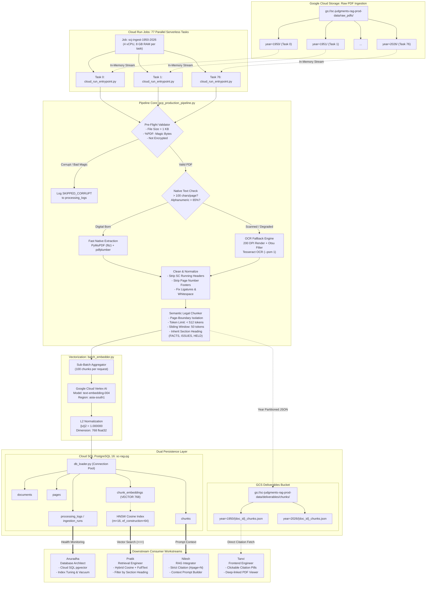

# Supreme Court Judgment RAG System — End-to-End Pipeline & Architecture Specification

**Author**: Kedar (Data Ingestion & Pipeline Engineer)  
**Dataset Target**: ~43,000 Indian Supreme Court Judgments (1950 – 2026)  
**GCP Project**: `sc-judgments-rag` (Project Number: `315039048199`) | **Region**: `asia-south1` (Mumbai)  
**GCS Bucket**: `gs://sc-judgments-rag-prod-data`  
**Cloud SQL PostgreSQL Instance**: `sc-rag-pg` (`34.93.53.176`, PostgreSQL 16)  
**Active Production Execution**: `scj-ingest-1950-2026-bmh4j`  
**Repository**: [github.com/Kedarlimbalkar/parsing](https://github.com/Kedarlimbalkar/parsing)  

---

## 1. Executive Summary & Production Status

The **Data Ingestion, Parsing, Chunking & Embedding Pipeline** is the foundational data infrastructure for the Supreme Court Judgment RAG platform. Its purpose is to transform ~43,000 unstructured Indian Supreme Court judgment PDFs (spanning 77 years from 1950 to 2026) into high-fidelity, section-aware, page-isolated text chunks ($<512$ tokens), vectorize them using Google Cloud Vertex AI `text-embedding-004` (768 dimensions), and persist them into both partitioned Google Cloud Storage (GCS) deliverables and a Cloud SQL PostgreSQL 16 database with `pgvector` HNSW indexing.

### Current Production Milestone
- **Full Production Run Active**: Launched Cloud Run Job `scj-ingest-1950-2026` execution `scj-ingest-1950-2026-bmh4j`.
- **Parallelism**: 77 concurrent serverless tasks executing across 77 year partitions (1950 to 2026).
- **Resource Sizing**: 4 vCPU, 8 GB RAM per task, 24-hour execution timeout.
- **Dual Persistence Active**: Writing year-partitioned deliverables (`deliverables/chunks/year=YYYY/{doc_id}_chunks.json`) to GCS and streaming records to Cloud SQL PostgreSQL `sc-rag-pg`.

---

## 2. Chronological Record of Work Completed Till Now

| Phase | Milestone / Action | Outcome / Deliverables |
| :--- | :--- | :--- |
| **Phase 1: Architecture & Extraction** | Designed decoupled 2-stage pipeline; built streaming PDF extractor with OCR fallback. | `gcp_production_pipeline.py`, `config.py`. Automated failover between native PyMuPDF (`fitz`), `pdfplumber`, `pypdf`, and 200 DPI Tesseract OCR. |
| **Phase 2: Semantic Legal Chunking** | Implemented legal chunker with strict page isolation and section heading inheritance. | Chunks guaranteed $<512$ tokens, 50-token sliding window, tagged with `section_heading` (`FACTS`, `ISSUES`, `HELD`, etc.), deterministic ID `{doc_id}_p{page}_c{idx}`. |
| **Phase 3: Vertex AI Embedding** | Integrated Vertex AI `text-embedding-004` with 768 dimensions, L2 normalization, and sub-batching. | `batch_embedder.py`, `embedding_demo_for_anuradha.py`. Batch size 100 texts, cosine distance optimization ($\|v\|_2 = 1.0$), retry with exponential backoff. |
| **Phase 4: Database Schema & Loader** | Unified 9-table relational + vector schema for PostgreSQL 16 with `pgvector`. | `schema_cloudsql_pgvector.sql`, `db_loader.py`. HNSW cosine index (`m = 16, ef_construction = 64`), audit tables (`ingestion_runs`, `extraction_runs`, `processing_logs`), non-blocking GCS fallback. |
| **Phase 5: Containerization & Cloud Run** | Dockerized pipeline on Python 3.11 with non-root user and automated year distribution. | `Dockerfile`, `cloud_run_entrypoint.py`. Distributed 77 Cloud Run tasks mapping 1:1 to years 1950–2026 (`CLOUD_RUN_TASK_INDEX`). |
| **Phase 6: CI/CD & Security Hardening** | Set up GitHub Actions, fixed org policy constraints, eliminated hardcoded credentials. | `.github/workflows/deploy_cloud_run.yml`, `SECURITY_AND_CREDENTIAL_HARDENING.md`. Keyless Cloud Shell deployment complying with `iam.disableServiceAccountKeyCreation`. |
| **Phase 7: Testing & Validation** | Automated test suite with synthetic PDF generator and edge case validation. | `tests/test_ingestion.py` (9 tests passing in ~5s). Validated corrupt files, encrypted PDFs, OCR fallbacks, and token boundaries. |
| **Phase 8: Team Handoffs** | Created tailored operational handoff contracts for all 7 downstream team members. | `docs/handoffs/` for Anuradha (DB), Pratik (Retrieval), Prathmesh (DevOps), Nilesh (RAG), Tanvi (Frontend), Kusuma (QA), Aakash (CI/CD). |
| **Phase 9: Production Launch** | Deployed container image to GCP Artifact Registry and triggered 77-task Cloud Run Job. | Image `asia-south1-docker.pkg.dev/sc-judgments-rag/scj-repo/scj-pipeline:latest`. Launched execution `scj-ingest-1950-2026-bmh4j`. |

---

## 3. Our Technical Approach & Design Principles

### 3.1 Decoupled Two-Stage Architecture
1. **Stage 1: Streaming Ingestion, Parsing & Chunking**:
   - Streams PDFs in-memory from GCS bucket `gs://sc-judgments-rag-prod-data/raw_pdfs/pdfs/year=YYYY/` via `BytesIO`.
   - Never writes huge bulk PDFs to disk, eliminating container disk-full crashes.
   - Outputs partitioned JSON deliverables to `deliverables/chunks/year=YYYY/{doc_id}_chunks.json`.
2. **Stage 2: Vector Embedding & Database Sync**:
   - Reads chunk collections and vectorizes them using Vertex AI `text-embedding-004`.
   - Populates PostgreSQL `chunks.embedding` and `chunk_embeddings` tables.
   - **Benefit**: If embedding models change in the future (e.g. from 768-dim to a legal-specific model), Stage 2 can be re-run directly from GCS chunk deliverables without re-parsing 43,000 PDFs.

### 3.2 Multi-Tier Parsing with Intelligent OCR Fallback
- **Pre-flight Validation**: Checks file size (> 1 KB), PDF magic bytes (`%PDF-`), and encryption flags. Corrupt or unreadable files are logged in `processing_logs` with status `SKIPPED_CORRUPT` and do not crash the pipeline.
- **Tier 1 (Fast Digital Native)**: PyMuPDF (`fitz`) and `pdfplumber` extract text and detect page-level typography in <150 ms per document.
- **Tier 2 (Scanned / Degraded OCR Fallback)**: If extracted text contains fewer than 100 characters per page or has an alphanumeric density below 65%, the pipeline automatically renders the page at 200 DPI, applies Otsu binarization, and performs Tesseract OCR with `--psm 1 --oem 1`.
- **Header & Footer Stripping**: Supreme Court running headers (e.g., *"SUPREME COURT REPORTS [1978] 2 S.C.R."*) and page number footers are stripped to prevent noise in retrieval.

### 3.3 Semantic Legal Chunking
- **Strict Page-Boundary Isolation**: A chunk never spans across two PDF pages. Every chunk has an unambiguous `original_page_number`. This is non-negotiable for legal verification, enabling the frontend to deep-link directly to `document.pdf#page=N`.
- **Token Constraints**: Strict limit of $<512$ tokens (using `cl100k_base` tiktoken encoding) with a 50-token sliding window between contiguous chunks on the same page.
- **Legal Heading Inheritance**: Detects uppercase section banners (`FACTS`, `ISSUES`, `SUBMISSIONS`, `ARGUMENTS OF THE APPELLANT`, `FINDINGS OF THE COURT`, `ORDER`, `JUDGMENT`) and stamps them into the chunk's `section_heading` metadata. Child paragraphs inherit this context even if the heading was on an earlier paragraph.
- **Deterministic Identifier**: Each chunk is assigned a deterministic ID:
  $$\text{chunk\_id} = \{\text{doc\_id}\}\_\text{p}\{\text{page\_number}\}\_\text{c}\{\text{chunk\_index}\}$$
  *(e.g., `1993_1_p4_c0`)*. This enables idempotent upserts without duplicate records.

### 3.4 Dense Vector Embedding Specs
- **Model**: Google Cloud Vertex AI `text-embedding-004`.
- **Dimensions**: Strictly **768 floating-point dimensions**.
- **Task Type**: `RETRIEVAL_DOCUMENT` during ingestion; `RETRIEVAL_QUERY` during user search.
- **L2 Unit Normalization**: Every vector is normalized to unit length ($\|v\|_2 = 1.000000$). This makes inner product, cosine similarity, and Euclidean distance mathematically equivalent, optimizing vector search performance.
- **Sub-Batching**: Vectors are generated in sub-batches of 100 chunks with automatic retry on Vertex AI quota rate limits (429).

### 3.5 Dual-Persistence Pattern & Database Resilience
- **GCS Deliverables**: Formatted as `{doc_id}_chunks.json` under `deliverables/chunks/year=YYYY/`. Provides an immutable, human-inspectable backup.
- **Cloud SQL PostgreSQL 16 (`sc-rag-pg`)**:
  - Normalized 9-table schema (`documents`, `pages`, `chunks`, `chunk_embeddings`, `processing_logs`, `ingestion_runs`, `extraction_runs`, `embedding_cache`, `query_history`).
  - HNSW cosine index: `USING hnsw (embedding vector_cosine_ops) WITH (m = 16, ef_construction = 64)`.
  - Non-blocking resilience: If Cloud SQL is temporarily unreachable or undergoing maintenance, `db_loader.py` logs a warning and proceeds with GCS delivery, ensuring the extraction job never halts.

---

## 4. End-to-End Pipeline Architecture (Mermaid)



---

## 5. Detailed Component Inventory

```
parsing/
│
├── cloud_run_entrypoint.py       # Cloud Run orchestrator (maps TASK_INDEX 0-76 to years 1950-2026)
├── gcp_production_pipeline.py    # Stage 1: Streaming GCS extraction, OCR fallback & chunking
├── batch_embedder.py             # Stage 2: Vertex AI text-embedding-004 batch vectorizer (768-dim)
├── db_loader.py                  # PostgreSQL 16 & SQLite database adapter with safe upserts
├── config.py                     # Central configuration (paths, bucket names, credentials)
├── schema_cloudsql_pgvector.sql  # Production PostgreSQL 16 DDL (9 tables, HNSW index)
│
├── Dockerfile                    # Container definition (Python 3.11, Tesseract OCR, non-root user)
├── .dockerignore                 # Excludes local artifacts, .git, and venv from image build
├── deploy_cloud_run.sh           # One-touch Cloud Shell deployment script
│
├── .github/workflows/
│   └── deploy_cloud_run.yml      # CI/CD pipeline for automated testing and deployment
│
├── tests/
│   └── test_ingestion.py         # 9 automated tests (validation, extraction, chunking, contracts)
│
└── docs/
    ├── END_TO_END_PIPELINE_AND_ARCHITECTURE.md   # This comprehensive master document
    ├── DATABASE_LOGGING_AND_AUDIT_SPEC.md        # DB logging tables, audit queries, verification
    ├── HOW_WE_DID_THE_EMBEDDING.md               # Deep-dive embedding methodology
    ├── CLOUD_RUN_PRODUCTION_GUIDE.md             # DevOps sizing, memory limits, and scaling
    └── handoffs/                                 # Specialized handoff contracts for teammates
        ├── HANDOFF_ANURADHA_DATABASE.md
        ├── HANDOFF_PRATIK_RETRIEVAL.md
        ├── HANDOFF_PRATHMESH_DEVOPS.md
        ├── HANDOFF_NILESH_RAG_INTEGRATOR.md
        ├── HANDOFF_TANVI_FRONTEND.md
        ├── HANDOFF_KUSUMA_QA.md
        └── HANDOFF_AAKASH_CICD.md
```

---

## 6. Verification Queries & Operational Monitoring

### 6.1 Checking Active Cloud Run Execution Status
```bash
gcloud run jobs executions describe scj-ingest-1950-2026-bmh4j --region=asia-south1
```

### 6.2 Monitoring GCS Deliverables Output
```bash
# Check deliverables created by year
gcloud storage ls gs://sc-judgments-rag-prod-data/deliverables/chunks/

# Check chunks for year 1950
gcloud storage ls gs://sc-judgments-rag-prod-data/deliverables/chunks/year=1950/
```

### 6.3 Verifying Cloud SQL Database Ingestion
Connect via **Cloud SQL Studio** in GCP Console or via Cloud Shell:
```sql
-- Check total records ingested
SELECT 
    (SELECT COUNT(*) FROM documents) AS total_documents,
    (SELECT COUNT(*) FROM pages) AS total_pages,
    (SELECT COUNT(*) FROM chunks) AS total_chunks,
    (SELECT COUNT(*) FROM chunk_embeddings WHERE sync_status = 'SYNCED') AS total_synced_embeddings;

-- Inspect most recent pipeline log entries
SELECT run_id, doc_id, stage, status, message, created_at 
FROM processing_logs 
ORDER BY created_at DESC 
LIMIT 20;

-- Test Cosine Similarity Search on HNSW Index
SELECT chunk_id, doc_id, original_page_number, section_heading, text_preview,
       1 - (embedding <=> '[0.012, -0.045, ...]'::vector(768)) AS similarity
FROM chunk_embeddings
JOIN chunks USING (chunk_id)
ORDER BY embedding <=> '[0.012, -0.045, ...]'::vector(768)
LIMIT 5;
```

---

## 7. Key Operational Contracts

1. **Embedding Dimension**: Strictly **768 dimensions** (`text-embedding-004`).
2. **Page Integrity**: Zero cross-page chunks. Every chunk maps to an exact physical page number.
3. **Database Safety**: Idempotent upserts (`ON CONFLICT DO NOTHING / UPDATE`). Anuradha's tables are never dropped.
4. **Offline Resilience**: If Cloud SQL credentials are not supplied or the database is unreachable, all chunks are preserved in GCS deliverables for immediate bulk load at a later time.

