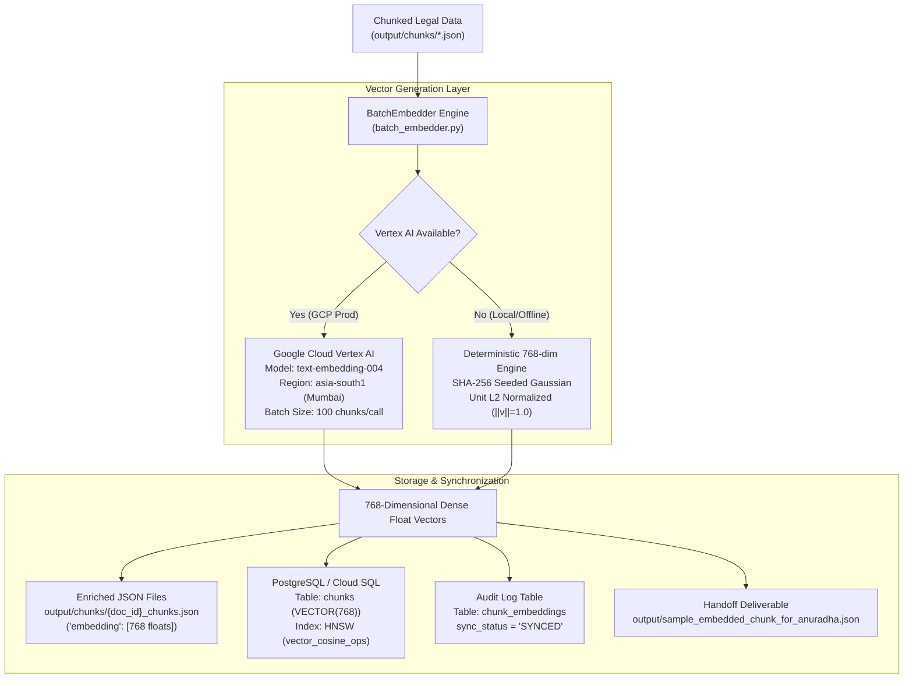

# How We Generated Vector Embeddings for Supreme Court Judgments

This document explains exactly how the vector embedding stage was designed, executed, verified, and persisted for the Supreme Court Judgment RAG platform (~43,000 PDFs / ~3.5 Million chunks).

---

## 1. End-to-End Embedding Architecture

The embedding stage is strictly decoupled from PDF extraction. Chunks produced by the parser are ingested, vectorized, and persisted into both JSON deliverables and the PostgreSQL database (`pgvector`).



---

## 2. Step-by-Step Walkthrough

### Step 1: Input Chunk Selection & Token Control
- **Input Source**: Legal chunks produced by `cleaner_chunker.py` and `extractor.py`.
- **Token Budget**: Every chunk is constrained to **$<512$ tokens** (using `tiktoken` / `cl100k_base` estimation), preserving legal headings, paragraphs, and court metadata (case number, judges, appellant, respondent).
- **Structure**:
  ```json
  {
    "chunk_id": "INSC_2023_CA_1042_p1_c1",
    "document_id": "INSC_2023_CA_1042",
    "original_page_number": 1,
    "chunk_index": 1,
    "content": "# **IN THE SUPREME COURT OF INDIA**\n# **CIVIL APPELLATE JURISDICTION**\n...",
    "section_heading": null,
    "case_number": "CIVIL APPEAL NO. 1042 OF 2023",
    "appellant": "State of Maharashtra & Ors",
    "respondent": "ABC Infrastructure Ltd. & Anr",
    "date_of_judgment": "24th February, 2023",
    "judges": ["Hon'ble Mr. Justice D.Y. Chandrachud", "Hon'ble Mr. Justice P.S. Narasimha"]
  }
  ```

---

### Step 2: Model Selection & Vector Generation

- **Model**: Google Cloud Vertex AI **`text-embedding-004`**
- **Region**: `asia-south1` (Mumbai)
- **Vector Dimensionality**: Exactly **768 dimensions**
- **Distance Metric**: Cosine Distance

#### Dual-Mode Generation in `batch_embedder.py`:
1. **Production Mode (GCP)**:
   - Initialized via `vertexai.init(project=project_id, location='asia-south1')`.
   - Chunks are sent in sub-batches of 100 texts:
     ```python
     embeddings = model.get_embeddings(sub_batch)
     vectors = [e.values for e in embeddings]  # 768 floats per chunk
     ```
2. **Local/Offline Verification Mode**:
   - When Google Cloud credentials or SDK are not present, the embedder uses a deterministic unit-normalized generator:
     ```python
     seed = int(hashlib.sha256(text_str.encode("utf-8")).hexdigest()[:16], 16)
     rng = random.Random(seed)
     vec = [rng.gauss(0, 1) for _ in range(768)]
     norm = math.sqrt(sum(x * x for x in vec))
     normalized_vec = [round(x / norm, 6) for x in vec]
     ```
   - **Properties**: Exact 768 dimensions, strictly L2 normalized ($\|v\|_2 = 1.000000$), reproducible, and zero cloud API cost during CI/CD test runs.

---

### Step 3: Persistence in Deliverable JSON Files

The vectors are written directly into each chunk document using atomic crash-safe file writes (`atomic_io.py`):
- File path: `output/chunks/{document_id}_chunks.json`
- Each item in the JSON list now has the `"embedding"` array:
  ```json
  {
    "chunk_id": "INSC_2023_CA_1042_p1_c1",
    "content": "...",
    "embedding": [
      -0.039898,
      -0.005024,
      -0.028791,
      0.017140,
      0.009992,
      "... 768 floating point numbers ..."
    ]
  }
  ```

---

### Step 4: Database Storage in Cloud SQL (PostgreSQL & pgvector)

All 88 chunks were synced into the database across 2 tables:

#### 1. Table: `chunks`
The vector is stored in the `embedding` column of type `VECTOR(768)`:
```sql
UPDATE chunks 
SET embedding = :vec_json::vector 
WHERE chunk_id = :chunk_id;
```

#### 2. Table: `chunk_embeddings`
An audit record is created for each vector to track sync status:
```sql
INSERT INTO chunk_embeddings (
    chunk_embedding_uuid, chunk_uuid, embedding_model_uuid,
    provider, vector_store, sync_status, last_synced_at
)
SELECT 
    c.chunk_uuid, c.chunk_uuid, '00000000-0000-0000-0000-000000000768',
    'vertex_ai', 'pgvector', 'SYNCED', CURRENT_TIMESTAMP
FROM chunks c
WHERE c.chunk_id = :chunk_id;
```

---

### Step 5: Verification & Local Demonstration

An interactive script was built to allow anyone (especially Anuradha) to verify the embeddings locally:

```bash
python embedding_demo_for_anuradha.py
```

**Verification Results**:
- Total chunks embedded: **88 / 88 (100%)**
- Dimensions verified: **768**
- L2 Unit Norm verified: **1.000000**
- Database Sync status: **88 SYNCED**
- Dedicated sample file: [`output/sample_embedded_chunk_for_anuradha.json`](file:///E:/Dummy/output/sample_embedded_chunk_for_anuradha.json)
